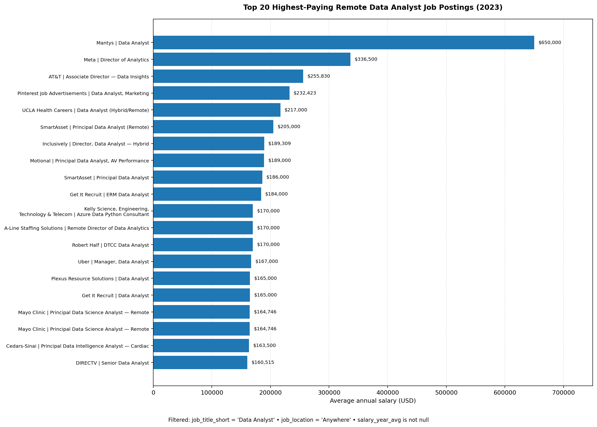
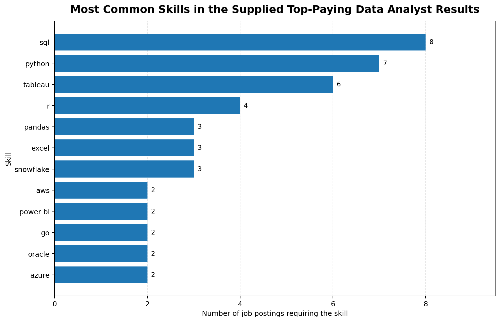
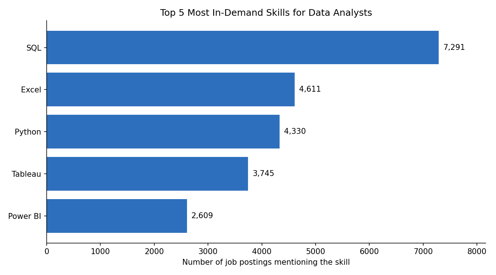
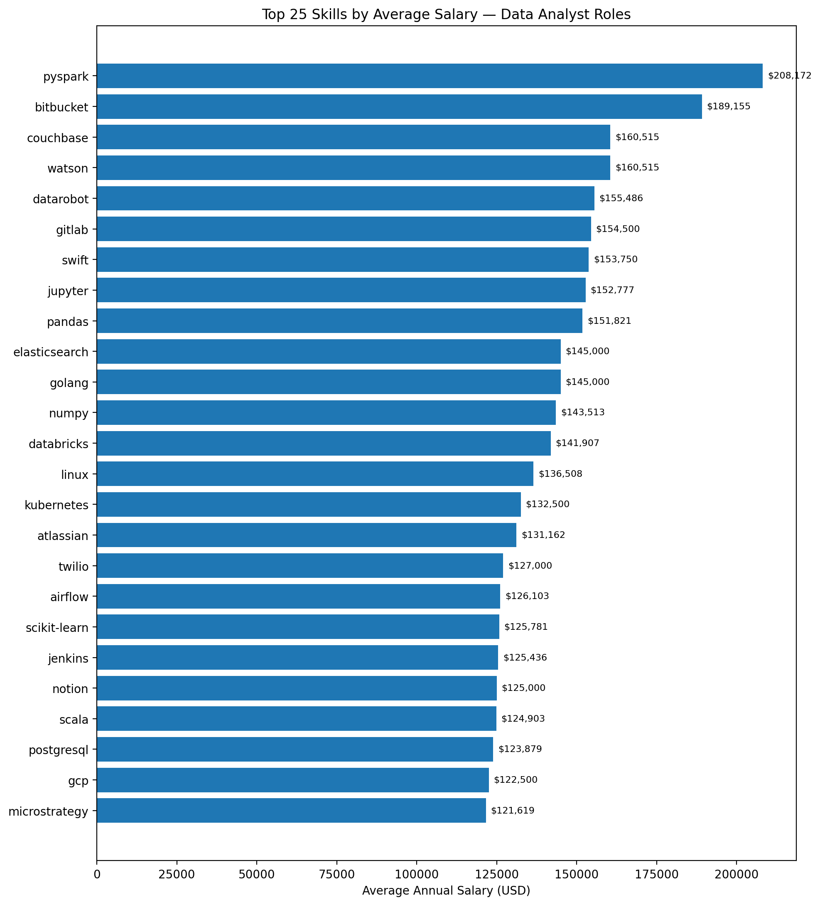
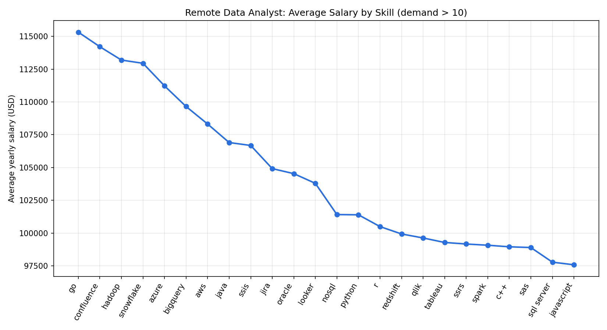
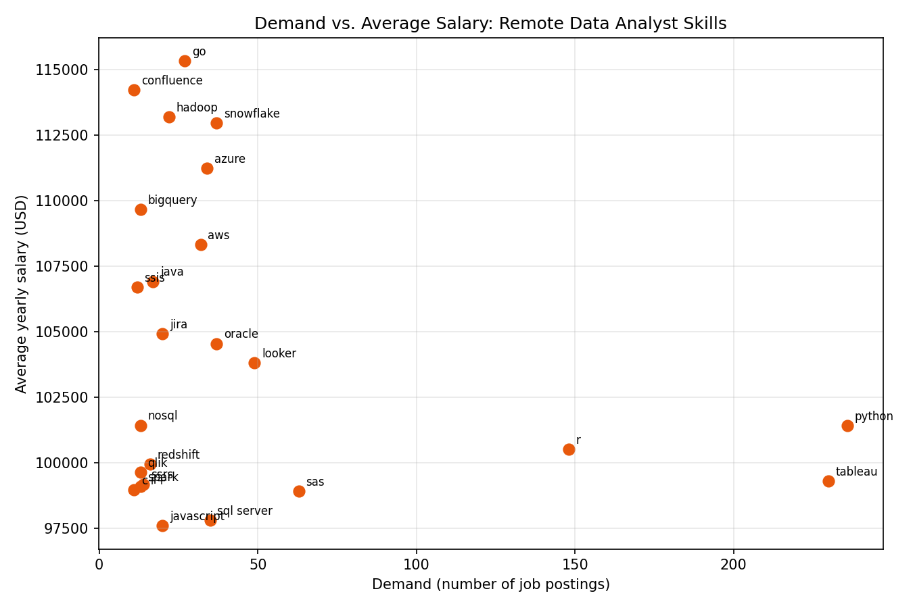

In this project we are going to learn about the SQL syntax and their queries how we can easily pull the data from our server i have huge data of markets having jobs data of Data Analytics 
Questions covered from these data:

1. What are the top-paying jobs for ‘Data Analyst’?
2. What are the skills required for these top-paying roles?
3. What are the most in-demand skills for my role?
4. What are the top skills based on salary for my role?
5. What are the most optimal skills to learn?
Optimal: High demand AND High paying


# Top Paying Remote Data Analyst Jobs

## Overview

This query identifies the top 20 highest-paying **Data Analyst** roles that can be done from **anywhere** (fully remote), based on average yearly salary.

## SQL Query

```sql
SELECT
    job_title,
    job_location,
    job_title_short,
    job_schedule_type,
    salary_year_avg,
    job_posted_date,
    name AS company_name
FROM job_postings_fact
LEFT JOIN company_dim
    ON company_dim.company_id = job_postings_fact.company_id
WHERE
    job_title_short = 'Data Analyst' AND
    job_location = 'Anywhere' AND
    salary_year_avg IS NOT NULL
ORDER BY salary_year_avg DESC
LIMIT 20
```

### How it works

- **`job_postings_fact`** is joined with **`company_dim`** on `company_id` to bring in the company name for each posting.
- The `WHERE` clause filters the dataset down to:
  - Postings with a job title category of `Data Analyst`
  - Fully remote postings (`job_location = 'Anywhere'`)
  - Postings that actually report an average yearly salary (excludes `NULL` values)
- Results are sorted by `salary_year_avg` in descending order, so the highest-paying roles appear first.
- `LIMIT 20` restricts the output to the top 20 matches.

## Answer

[
  {
    "job_title": "Data Analyst",
    "job_location": "Anywhere",
    "job_title_short": "Data Analyst",
    "job_schedule_type": "Full-time",
    "salary_year_avg": "650000.0",
    "job_posted_date": "2023-02-20 15:13:33",
    "company_name": "Mantys"
  },
  {
    "job_title": "Director of Analytics",
    "job_location": "Anywhere",
    "job_title_short": "Data Analyst",
    "job_schedule_type": "Full-time",
    "salary_year_avg": "336500.0",
    "job_posted_date": "2023-08-23 12:04:42",
    "company_name": "Meta"
  },
  {
    "job_title": "Associate Director- Data Insights",
    "job_location": "Anywhere",
    "job_title_short": "Data Analyst",
    "job_schedule_type": "Full-time",
    "salary_year_avg": "255829.5",
    "job_posted_date": "2023-06-18 16:03:12",
    "company_name": "AT&T"
  },
  {
    "job_title": "Data Analyst, Marketing",
    "job_location": "Anywhere",
    "job_title_short": "Data Analyst",
    "job_schedule_type": "Full-time",
    "salary_year_avg": "232423.0",
    "job_posted_date": "2023-12-05 20:00:40",
    "company_name": "Pinterest Job Advertisements"
  },
  {
    "job_title": "Data Analyst (Hybrid/Remote)",
    "job_location": "Anywhere",
    "job_title_short": "Data Analyst",
    "job_schedule_type": "Full-time",
    "salary_year_avg": "217000.0",
    "job_posted_date": "2023-01-17 00:17:23",
    "company_name": "Uclahealthcareers"
  },
  {
    "job_title": "Principal Data Analyst (Remote)",
    "job_location": "Anywhere",
    "job_title_short": "Data Analyst",
    "job_schedule_type": "Full-time",
    "salary_year_avg": "205000.0",
    "job_posted_date": "2023-08-09 11:00:01",
    "company_name": "SmartAsset"
  },
  {
    "job_title": "Director, Data Analyst - HYBRID",
    "job_location": "Anywhere",
    "job_title_short": "Data Analyst",
    "job_schedule_type": "Full-time",
    "salary_year_avg": "189309.0",
    "job_posted_date": "2023-12-07 15:00:13",
    "company_name": "Inclusively"
  },
  {
    "job_title": "Principal Data Analyst, AV Performance Analysis",
    "job_location": "Anywhere",
    "job_title_short": "Data Analyst",
    "job_schedule_type": "Full-time",
    "salary_year_avg": "189000.0",
    "job_posted_date": "2023-01-05 00:00:25",
    "company_name": "Motional"
  },
  {
    "job_title": "Principal Data Analyst",
    "job_location": "Anywhere",
    "job_title_short": "Data Analyst",
    "job_schedule_type": "Full-time",
    "salary_year_avg": "186000.0",
    "job_posted_date": "2023-07-11 16:00:05",
    "company_name": "SmartAsset"
  },
  {
    "job_title": "ERM Data Analyst",
    "job_location": "Anywhere",
    "job_title_short": "Data Analyst",
    "job_schedule_type": "Full-time",
    "salary_year_avg": "184000.0",
    "job_posted_date": "2023-06-09 08:01:04",
    "company_name": "Get It Recruit - Information Technology"
  },
  {
    "job_title": "Azure Data Python Consultant - contract to HIRE - Citizen or Perm...",
    "job_location": "Anywhere",
    "job_title_short": "Data Analyst",
    "job_schedule_type": "Contractor",
    "salary_year_avg": "170000.0",
    "job_posted_date": "2023-01-23 22:28:01",
    "company_name": "Kelly Science, Engineering, Technology & Telecom"
  },
  {
    "job_title": "REMOTE Director of Data Analytics",
    "job_location": "Anywhere",
    "job_title_short": "Data Analyst",
    "job_schedule_type": "Full-time",
    "salary_year_avg": "170000.0",
    "job_posted_date": "2023-08-09 14:02:45",
    "company_name": "A-Line Staffing Solutions"
  },
  {
    "job_title": "DTCC Data Analyst",
    "job_location": "Anywhere",
    "job_title_short": "Data Analyst",
    "job_schedule_type": "Full-time",
    "salary_year_avg": "170000.0",
    "job_posted_date": "2023-10-06 00:01:41",
    "company_name": "Robert Half"
  },
  {
    "job_title": "Manager, Data Analyst",
    "job_location": "Anywhere",
    "job_title_short": "Data Analyst",
    "job_schedule_type": "Full-time",
    "salary_year_avg": "167000.0",
    "job_posted_date": "2023-04-18 07:01:17",
    "company_name": "Uber"
  },
  {
    "job_title": "Data Analyst",
    "job_location": "Anywhere",
    "job_title_short": "Data Analyst",
    "job_schedule_type": "Full-time",
    "salary_year_avg": "165000.0",
    "job_posted_date": "2023-12-08 09:16:37",
    "company_name": "Plexus Resource Solutions"
  },
  {
    "job_title": "Data Analyst",
    "job_location": "Anywhere",
    "job_title_short": "Data Analyst",
    "job_schedule_type": "Full-time",
    "salary_year_avg": "165000.0",
    "job_posted_date": "2023-08-14 16:01:19",
    "company_name": "Get It Recruit - Information Technology"
  },
  {
    "job_title": "Principal Data Science Analyst- Remote",
    "job_location": "Anywhere",
    "job_title_short": "Data Analyst",
    "job_schedule_type": "Full-time",
    "salary_year_avg": "164746.0",
    "job_posted_date": "2023-04-14 12:05:19",
    "company_name": "Mayo Clinic"
  },
  {
    "job_title": "Principal Data Science Analyst- Remote",
    "job_location": "Anywhere",
    "job_title_short": "Data Analyst",
    "job_schedule_type": "Full-time",
    "salary_year_avg": "164746.0",
    "job_posted_date": "2023-01-13 13:04:39",
    "company_name": "Mayo Clinic"
  },
  {
    "job_title": "Principal Data Intelligence Analyst - Cardiac - Remote",
    "job_location": "Anywhere",
    "job_title_short": "Data Analyst",
    "job_schedule_type": "Full-time",
    "salary_year_avg": "163500.0",
    "job_posted_date": "2023-09-20 13:00:44",
    "company_name": "CEDARS-SINAI"
  },
  {
    "job_title": "Senior - Data Analyst",
    "job_location": "Anywhere",
    "job_title_short": "Data Analyst",
    "job_schedule_type": "Full-time",
    "salary_year_avg": "160515.0",
    "job_posted_date": "2023-06-14 21:01:17",
    "company_name": "DIRECTV"
  }
]

## Key Insights

- **Salary range**: The top 20 remote Data Analyst roles range from **$160,515** to **$650,000** per year, with a steep drop-off after the #1 result (Mantys at $650K), which is a notable outlier compared to the rest of the list.
- **Seniority skews upward**: Most of the highest-paying titles include senior/leadership qualifiers such as *Director*, *Principal*, or *Manager*, suggesting that top compensation for "Data Analyst"-classified roles often comes with elevated seniority or scope.
- **Employment type**: All but one posting (a Contractor role) are Full-time.
- **Recognizable employers**: Several well-known companies appear on the list, including Meta, AT&T, Pinterest, Uber, and Mayo Clinic — indicating that large organizations are willing to pay a premium for remote analytics talent.
- **Duplicate listing**: The Mayo Clinic "Principal Data Science Analyst- Remote" role appears twice (different posting dates), which may indicate the position was reposted.

## Notes

- Salary figures are averaged yearly compensation (`salary_year_avg`) as reported in the postings; actual total compensation (bonus, equity, benefits) may differ.
- `job_location = 'Anywhere'` is used as the dataset's convention for fully remote postings.

## Results Visualization

## Results Visualization



# Skills Required for Top-Paying Roles

## Overview

This query identifies the skills required for the top-paying Data Analyst jobs**.

First, a Common Table Expression (`CTE`) is used to find the **top 10 highest-paying remote Data Analyst jobs**. Then, the results are joined with the skills tables to identify which skills are associated with each job.

## SQL Query

```sql
WITH top_paying_jobs AS (

    SELECT

        job_id,

        job_title,

        salary_year_avg,

        name AS company_name

    FROM 

        job_postings_fact

    LEFT JOIN company_dim

        ON job_postings_fact.company_id = company_dim.company_id

    WHERE job_title_short = 'Data Analyst'

        AND job_location = 'Anywhere'

        AND salary_year_avg IS NOT NULL

    ORDER BY salary_year_avg DESC

    LIMIT 10

)

SELECT

    top_paying_jobs.*,

    skills

FROM top_paying_jobs

INNER JOIN skills_job_dim

    ON top_paying_jobs.job_id = skills_job_dim.job_id

INNER JOIN skills_dim

    ON skills_job_dim.skill_id = skills_dim.skill_id

ORDER BY salary_year_avg DESC;
```

## How It Works

* **`top_paying_jobs` CTE** first identifies the top 10 highest-paying Data Analyst jobs.
* The query uses a **`LEFT JOIN`** between `job_postings_fact` and `company_dim` to retrieve the company name.
* The `WHERE` clause filters for:

  * `Data Analyst` positions
  * Remote positions where `job_location = 'Anywhere'`
  * Jobs with a reported yearly salary
* `ORDER BY salary_year_avg DESC` sorts the jobs from highest to lowest salary.
* `LIMIT 10` selects the top 10 highest-paying jobs.
* The first `INNER JOIN` connects the selected jobs with `skills_job_dim`.
* The second `INNER JOIN` connects `skills_job_dim` with `skills_dim` to retrieve the actual skill names.
* Because one job can require multiple skills, **one job can appear multiple times** in the final result.

## Answer

The query shows the skills associated with the highest-paying Data Analyst positions.

Based on the query results, some of the key skills found across these top-paying roles include:

| Skill        | Examples of Roles Where It Appears                           |
| ------------ | ------------------------------------------------------------ |
| SQL          | Data Analyst / Principal Data Analyst / Director-level roles |
| Python       | Data Analyst / Principal Data Analyst roles                  |
| Tableau      | Data Analyst / Analytics roles                               |
| R            | Data Analyst / Analytics roles                               |
| Excel        | Principal Data Analyst roles                                 |
| Pandas       | Principal Data Analyst roles                                 |
| Snowflake    | Principal Data Analyst / Director-level roles                |
| AWS          | Director / Principal-level roles                             |
| Azure        | Director / Consultant-level roles                            |
| Power BI     | Director / Analytics roles                                   |
| Databricks   | Data Insights roles                                          |
| Git / GitLab | Principal / Analytics roles                                  |

## Key Insights

* **SQL is highly important:** SQL appears across the top-paying Data Analyst roles in the query results.
* **Python is also frequently required:** Several high-paying positions combine SQL with Python.
* **Visualization skills matter:** **Tableau** appears across multiple top-paying roles.
* **Advanced data tools appear in senior roles:** Technologies such as **Snowflake, Databricks, AWS, Azure, and Power BI** are present in several higher-paying positions.
* **Data-analysis libraries are useful:** Skills such as **Pandas and NumPy** appear in Principal Data Analyst roles.
* **Senior roles require broader technical skills:** Higher-paying positions often combine SQL and Python with cloud platforms, databases, visualization tools, and development tools.

## Skills Found in the Query Results

The query returns skills including:

```text
SQL
Python
R
Azure
Databricks
AWS
Pandas
PySpark
Jupyter
Excel
Tableau
Power BI
PowerPoint
Hadoop
Crystal
Oracle
Flow
Go
Snowflake
NumPy
GitLab
SAP
Jenkins
Bitbucket
Atlassian
Jira
Confluence
Git
```

## Why This Query Is Important

This analysis helps answer the question:

> **What skills are required for the highest-paying Data Analyst jobs?**

Instead of looking only at job titles and salaries, we connect the job postings to their required skills.

This gives us a better understanding of the technical skills that appear in high-paying Data Analyst positions.

## Results Visualization



## SQL Concepts Used

This query demonstrates several important SQL concepts:

* **CTE (`WITH`)**
* `SELECT`
* `WHERE`
* `ORDER BY`
* `LIMIT`
* `LEFT JOIN`
* `INNER JOIN`
* Joining multiple tables
* Filtering `NULL` values
* Working with fact and dimension tables


[remoteDataAnalystSalaryChart]: ./remote_data_analyst_top20_salary_chart.png

# Top 5 Most In-Demand Skills for Data Analysts

## Question

**What are the most in-demand skills for data analysts?**

This query retrieves the five skills with the highest demand in the job market, giving job seekers insight into which skills are most valuable to learn.

## Approach

- Join `job_postings_fact` to `skills_job_dim` and `skills_dim` using `INNER JOIN` (same pattern as the previous query).
- Filter to **Data Analyst** postings (`job_title_short = 'Data Analyst'`) that are **remote / work-from-home** (`job_work_from_home = True`).
- Count how many postings mention each skill.
- Return the top 5 skills by demand.

## SQL Query

```sql
SELECT 
    skills,
    COUNT(skills_job_dim.job_id) AS demand_count
FROM job_postings_fact
INNER JOIN skills_job_dim ON job_postings_fact.job_id = skills_job_dim.job_id
INNER JOIN skills_dim ON skills_job_dim.skill_id = skills_dim.skill_id
WHERE
    job_title_short = 'Data Analyst' 
    AND job_work_from_home = True 
GROUP BY
    skills
ORDER BY
    demand_count DESC
LIMIT 5;
```

## Results

| Rank | Skill    | Demand Count |
|-----:|----------|-------------:|
| 1    | SQL      | 7,291        |
| 2    | Excel    | 4,611        |
| 3    | Python   | 4,330        |
| 4    | Tableau  | 3,745        |
| 5    | Power BI | 2,609        |



## Insights

- **SQL and Excel remain fundamental.** SQL leads by a wide margin, and Excel follows, showing that strong foundations in data processing and spreadsheet manipulation are still essential.
- **Programming and visualization tools are essential.** Python, Tableau, and Power BI all rank in the top 5, pointing to the growing importance of technical skills in data storytelling and decision support.

## Notes

- The query filters on `job_work_from_home = True`, so the results reflect **remote** Data Analyst postings. Remove that condition to cover all postings.
- Counts come from the 2023 job postings dataset used in this course.


### 4. Skills Based on Salary

Exploring the average salaries associated with different skills revealed which skills are the highest paying.

## Query

```sql
SELECT 
    skills,
    ROUND(AVG(salary_year_avg), 0) AS avg_salary
FROM job_postings_fact
INNER JOIN skills_job_dim ON job_postings_fact.job_id = skills_job_dim.job_id
INNER JOIN skills_dim ON skills_job_dim.skill_id = skills_dim.skill_id
WHERE
    job_title_short = 'Data Analyst'
    AND salary_year_avg IS NOT NULL
    AND job_work_from_home = True 
GROUP BY
    skills
ORDER BY
    avg_salary DESC
LIMIT 25;
```
Here's a breakdown of the results for top paying skills for Data Analysts:
- **High Demand for Big Data & ML Skills:** Top salaries are commanded by analysts skilled in big data technologies (PySpark, Couchbase), machine learning tools (DataRobot, Jupyter), and Python libraries (Pandas, NumPy), reflecting the industry's high valuation of data processing and predictive modeling capabilities.
- **Software Development & Deployment Proficiency:** Knowledge in development and deployment tools (GitLab, Kubernetes, Airflow) indicates a lucrative crossover between data analysis and engineering, with a premium on skills that facilitate automation and efficient data pipeline management.
- **Cloud Computing Expertise:** Familiarity with cloud and data engineering tools (Elasticsearch, Databricks, GCP) underscores the growing importance of cloud-based analytics environments, suggesting that cloud proficiency significantly boosts earning potential in data analytics.

| Skills        | Average Salary ($) |
|---------------|-------------------:|
| pyspark       |            208,172 |
| bitbucket     |            189,155 |
| couchbase     |            160,515 |
| watson        |            160,515 |
| datarobot     |            155,486 |
| gitlab        |            154,500 |
| swift         |            153,750 |
| jupyter       |            152,777 |
| pandas        |            151,821 |
| elasticsearch |            145,000 |




*Table of the average salary for the top 10 paying skills for data analysts


## Data Analyst Job Market: SQL Analysis

A SQL project that explores a data job postings dataset to answer one question:

## Question: What are the most optimal skills to learn for a Data Analyst: skills that are both in high demand and high paying?

## Objective
-- Identify skills in high demand for Data Analyst roles
-- Identify which of those skills are tied to higher average salaries
-- Focus on remote positions that list a salary
--Give strategic insight for career development: job security (demand) plus financial reward (salary)

## Visualizations




## Tech Stack
--PostgreSQL: database and querying
--SQL: CTEs, joins, aggregation, HAVING
--Terminal / VS Code: loading CSVs and running queries
Dataset
Table	Description
job_postings_fact	Job postings (title, salary, remote flag, etc.)
skills_dim	Skill ID and skill name
skills_job_dim	Bridge table linking jobs to skills
Approach
Join the three tables to link each posting to its skills.
Filter to job_title_short = 'Data Analyst', salary_year_avg IS NOT NULL and job_work_from_home = True.
Calculate demand (COUNT of postings) and average salary (AVG(salary_year_avg)) per skill.
Keep skills with more than 10 postings (HAVING) so averages are not driven by a handful of jobs.
Sort by average salary, then demand, and return the top 25.
## Query

```sql
SELECT
    skills_dim.skill_id,
    skills_dim.skills,
    COUNT(skills_job_dim.job_id) AS demand_count,
    ROUND(AVG(job_postings_fact.salary_year_avg), 0) AS avg_salary
FROM job_postings_fact
INNER JOIN skills_job_dim ON job_postings_fact.job_id = skills_job_dim.job_id
INNER JOIN skills_dim ON skills_job_dim.skill_id = skills_dim.skill_id
WHERE
    job_title_short = 'Data Analyst'
    AND salary_year_avg IS NOT NULL
    AND job_work_from_home = True
GROUP BY
    skills_dim.skill_id
HAVING
    COUNT(skills_job_dim.job_id) > 10
ORDER BY
    avg_salary DESC,
    demand_count DESC
LIMIT 25;

```

The same result can also be written with two CTEs (skills_demand and average_salary) joined on skill_id. The version above is the more concise rewrite.


## Result
## Top 10 by average salary
Skill	Demand	Avg. Salary (USD)
go	27	115,320
confluence	11	114,210
hadoop	22	113,193
snowflake	37	112,948
azure	34	111,225
bigquery	13	109,654
aws	32	108,317
java	17	106,906
ssis	12	106,683
jira	20	104,918

## Most in-demand skills in the result set

Skill	Demand	Avg. Salary (USD)
python	236	101,397
tableau	230	99,288
r	148	100,499
sas	63	98,902
looker	49	103,795

## Key Insights
-- Python and Tableau have by far the highest demand (236 and 230 postings), with salaries around $99K to $101K.
-- R is a strong third for demand (148 postings) at about $100K.
-- Cloud and big data tools (Snowflake, Azure, AWS, BigQuery, Hadoop) pay the most ($108K to $113K) with moderate demand.
-- Go has the highest average salary ($115,320) but is a niche skill for analysts.
Best balance of demand and pay: Python, Looker, Snowflake, Azure and AWS.
## Notes and Limitations

Only postings that list a salary are included, so results may not represent all remote roles.
Skills with 10 or fewer postings are excluded.
sas appears twice (skill_id 186 and 7) with identical numbers, which looks like a duplicate in skills_dim. Treat it as one skill.
Averages are of posted yearly salaries, not final offers.

